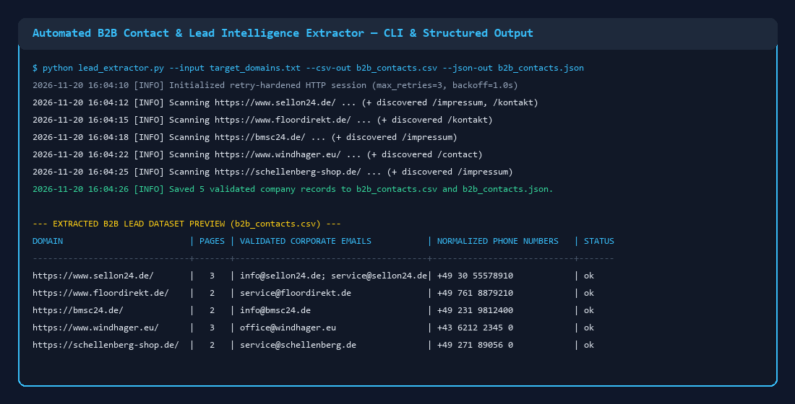

# Automated B2B Contact & Lead Intelligence Extractor



A resilient Python CLI pipeline (`requests` + `BeautifulSoup4` + `urllib3.Retry`) built for B2B lead generation and digital operations. Crawls target company domains, automatically inspects `/contact`, `/about`, and `/impressum` subpages, and extracts validated corporate email addresses and international phone numbers to structured CSV and JSON datasets.

## Features
- **Automatic Contact Subpage Discovery:** Follows high-probability contact/imprint links when the homepage has no direct email.
- **Retry-Hardened HTTP Session:** Connection pooling with automatic retries on transient `429/500/502/503/504` responses and polite rate-limiting.
- **Noise-Filtered Extraction:** Strips static asset extensions (`.png`, `.svg`, `.webp`) from email regex matches and normalizes international phone numbers (`8–15` digits).
- **Dual CSV & JSON Output:** Ready for direct import into Google Sheets, Excel, or HubSpot/CRM pipelines.

## Quick Start
```bash
pip install beautifulsoup4 requests
python lead_extractor.py --input target_domains.txt --csv-out b2b_contacts.csv --json-out b2b_contacts.json
```
